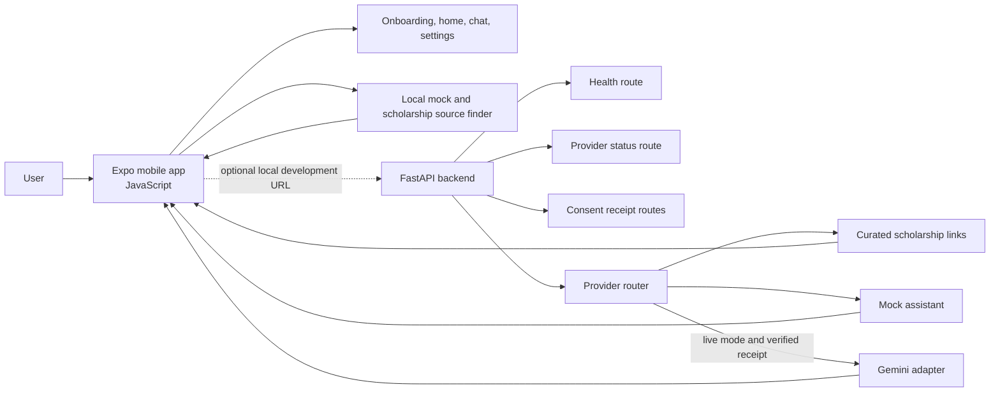
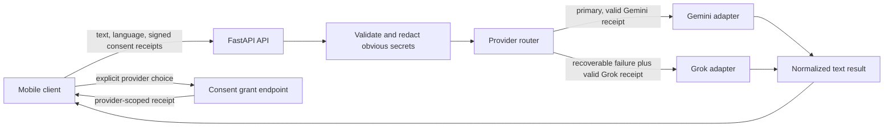

# Architecture

## Current prototype phase F

The mobile app is a JavaScript Expo client. It can provide local fixture replies with no network connection. If `EXPO_PUBLIC_API_BASE_URL` is configured, the app sends text to FastAPI. Mock mode is the default. Live mode requires `MOCK_MODE=false` and a configured Gemini key and model. Before sending recent chat context, the app asks for Gemini consent and then asks separately whether Grok may be used as a fallback; each choice receives a signed, provider-scoped backend receipt.

## Official scholarship source finder

Matching scholarship questions are checked against a small local keyword list in Marathi, Hindi, and English. A match returns localized guidance plus HTTPS links from the allowlist in [Official scholarship sources](OFFICIAL_SOURCES.md). This path runs before provider routing, so a matching question is not sent to Gemini or Grok. Offline mobile mode uses the same catalog and behavior.

This is source discovery only. The app does not fetch portal content or answer eligibility, award, deadline, or document questions. The user opens the relevant official portal to verify current details. The mobile and backend catalogs are currently mirrored and must be updated together.

## Provider fallback

Grok is called only after a recoverable Gemini error, when Grok is configured, and when the user has separately consented to that data transfer. Provider keys stay on the backend. Both adapters normalize responses and errors before returning them to the client.

The router makes one Gemini attempt and at most one Grok fallback attempt. It does not retry authentication or malformed-request failures and does not log message content. A timeout can leave the first provider's outcome uncertain; fallback can therefore mean both providers process the same text.

## Data flow and boundaries

- The mobile app sends a selected language and recent chat text only. There is no microphone access.
- Provider credentials are never shipped to the client.
- Mock responses are clearly identified. Gemini responses are not sourced government information.
- Gemini requests pass `store=false`; this does not override Google's other service terms.
- Grok requests use the Responses API with `store=false`; xAI's default request/response audit retention may still be 30 days unless Zero Data Retention is enabled for the account team.
- No app actions, arbitrary tools, form submission, or device automation are exposed to model output.
- Conversation history is in-memory UI state only and is deleted when cleared or when the app restarts. Consented Gemini and Grok requests include recent chat messages.

## Consent receipts

`POST /v1/consent/grant` issues a signed receipt for one configured, available provider and disclosure version. It does not call that provider. `POST /v1/assistant/reply` accepts receipts in `consent_receipts`; the backend validates signature, provider scope, disclosure version, expiry, and revocation before calling Gemini or Grok. Receipts expire after one hour, remain in the chat screen's memory, and are revoked when the user turns consent off, clears the conversation, or leaves the chat screen. The signing key is generated per backend process, so a restart invalidates outstanding receipts. The revocation list is also process-local.

If a provider disclosure changes, update its localized copy and increment the supported notice version so old receipts cannot authorize requests under a new disclosure.

This is a server-verifiable prototype receipt, not user authentication. The backend has no account or authenticated session, so an unauthenticated caller can directly request a receipt. It proves that the backend issued a provider-scoped grant, but cannot prove who clicked the consent UI. Receipts and revocations are process-local; use one backend process only. Keep the backend on a trusted development network; production use requires an approved identity/session and durable consent/revocation design.
