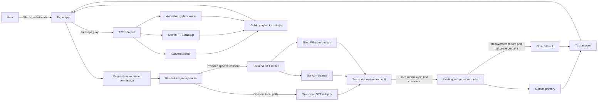

# Voice Architecture

**Status:** Design only. The mobile app currently has no microphone recording, STT, or TTS integration. Provider choice and device performance are not verified.

## Data flow

## Boundaries

- Recording begins only after the user presses a push-to-talk control. Show a recording indicator and stop/cancel actions.
- Ask for microphone permission at the moment recording is requested. Keep text-only mode usable without permission.
- First cloud STT slice should cap each request at 30 seconds to fit Saaras REST limits. Enforce file size, MIME type, and duration server-side. Longer recordings need a separately designed chunking/batch flow.
- Delete temporary audio after success, failure, timeout, or cancellation. Do not persist raw audio or generated audio by default.
- Return the transcript for user review/edit before sending it to an LLM. Do not silently translate speech to English.
- Disclose each external recipient separately. STT consent does not authorize Gemini/Grok text processing, and LLM consent does not authorize a speech provider.
- Do not automatically play generated audio. Show play, stop, replay, and supported speed controls; keep the answer readable if TTS fails.
- Split TTS input at sentence boundaries under the selected provider's documented limit. Preserve punctuation, numbers, dates, and currency.
- Use an offline or system fallback only when it reports the needed language. Do not claim Marathi support based only on the operating system or a provider's general multilingual label.

## Interfaces to add in a later phase

Keep the UI independent from vendors. Proposed contracts:

- `transcribe(audio, languageHint) -> transcript, detectedLanguage?, provider, requestId?`
- `synthesize(text, language, voicePreference) -> audio stream/file handle, provider, requestId?`
- `STTRouter` and `TTSRouter` choose only configured adapters with valid provider-specific consent and bounded timeouts.

The current backend only implements text assistant routing. These interfaces and routes are not implemented by Phase B.

## Platform plan

Start with Android. Expo/React Native remains the client stack, but recording and playback packages, native permissions, development-build requirements, and SDK compatibility must be checked at implementation time. Keep iOS and web adapters isolated. System voice availability varies by device; test available locales at runtime. `whisper.cpp` is an optional native offline research path, not a dependency for every user.
